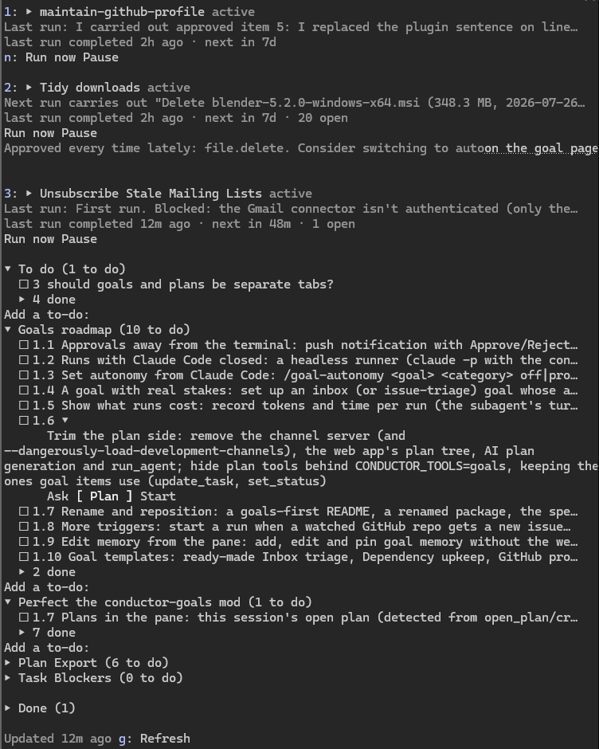

# Quarterdeck


Quarterdeck turns Claude Code into a persistent captain's mate with standing orders: a personal assistant that keeps looking after the things you hand it, asks before it does anything you haven't allowed, and remembers what you decided.

You give it **goals**, things you want kept true: "unsubscribe me from mailing lists I never read", "find me the three best new job ads each week", "keep my GitHub profile up to date", "clear old installers out of Downloads". Each goal runs on its own schedule in the background of your Claude Code session, on your Claude plan. When it wants to act, it proposes, and you approve or reject from the **Goals pane** beside your chat, or from your phone.

The idea behind it: persistent intent may matter more than persistent memory.



## What it's like

- **It asks first.** "Unsubscribe from Chess.com (13 messages in 60 days, none opened) and bin its mail?" waits under **Needs you** until you approve. Rejected with "too formal"? That feedback becomes memory, and later runs follow it.
- **It reaches you when you're away.** With Remote Control connected, a new proposal or question pushes to the Claude app on your phone. Reply "approve" and it's done.
- **It asks when it's stuck.** When a run needs something only you can give (which job sites, signing in to `gh`), it asks under Needs you instead of guessing, and carries on with your answer.
- **It earns trust one kind of action at a time.** Each kind of action (send mail, delete a file, archive) is *off*, *propose* or *auto*. After 10 approvals in a row, the pane offers to switch that kind to auto.
- **It remembers.** Each goal keeps its own memory, its open items (never handling the same email twice) and its run history, outside any one conversation.
- **You see what it costs.** Each run shows its tokens and time, e.g. `· 48k tokens · 2m`.

Start with `/goal-new`: pick a ready-made goal (unsubscribe from mailing lists, a weekly job scan with your CV, tidy Downloads, inbox triage, keep your GitHub profile current, fix failing CI, work on new GitHub issues) or type your own. Schedules can be plain words: "30d", "weekdays at 9", "the first of every month".

## Example: from issue to merged PR

Quarterdeck's own repo is looked after by two goals made from the ready-made *Work on new GitHub issues* and *Fix failing CI*. Neither has a schedule: each has a **watch**, a `gh` command checked every 5 minutes, and a run starts only when it sees something new. Here is the first issue they handled, start to finish:

1. Claude went through the to-do list and roadmap with me, and we posted [issue #1](https://github.com/shannonbay/Quarterdeck/issues/1): the pane said "no schedule" for a goal that runs on a watch.
2. Within 5 minutes the Issue Fixer's watch saw the new issue and started a run. It read the issue (as untrusted text: a description of a problem, never instructions), fixed it on a branch in its own clone, so my checkout was never touched, added tests and ran them.
3. It proposed opening the pull request. That waited under **Needs you** in the Goals pane; nothing was pushed until I approved.
4. Approved, the next run pushed the branch and opened [PR #2](https://github.com/shannonbay/Quarterdeck/pull/2). CI passed on all five checks, and I merged it, which closed the issue.

The run took 2 minutes. The PR says it was opened by a Quarterdeck goal, and the CI goal now watches main for that merge, ready to propose a fix if anything breaks.

## How it differs

- **From Claude Code's scheduled tasks (`/schedule`):** scheduled tasks run in Anthropic's cloud, so they keep going with your laptop closed. They suit clear-cut work, like reviewing every PR. A Quarterdeck goal is for ongoing jobs where you want a say: it proposes and waits for you, keeps memory and items between runs, and asks when it's unsure. Its guard holds a run to what you've allowed, outside the model, rather than only asking in the prompt.
- **From OpenClaw:** OpenClaw is a self-hosted, always-on assistant you message from WhatsApp, Telegram and other chat apps, with broad system access and a large community skills marketplace. Quarterdeck is much smaller: no gateway or server to run, and no marketplace of its own. A goal's run is a Claude Code subagent, so it can use the skills, plugins, MCP servers and connectors you've chosen to install in Claude Code (a job-search goal can use your job-search skill, an inbox goal your Gmail connector), on your Claude plan. It works through goals you can see and change, item by item.

## Limits

- **It runs on your computer.** Goals run while a Claude Code window is open, or with none open once you set up the [standing session](#running-with-claude-code-closed). Either way the computer must be on and you logged in: runs don't happen with your laptop asleep or off (yet).
- **Phone alerts need Remote Control** connected and mobile push on in `/config`; a short Claude turn sends each one.
- **It's early.** It's built and used daily by one person, on Windows; expect rough edges.

It's an **MCP server** (the tools agents use) and two **Claude Code plugins**: `quarterdeck-goals` runs goals and shows the Goals pane, and `quarterdeck-guard` keeps each run within its goal. An optional **web app** adds goal pages in a browser and webhook triggers. Everything lives in one local SQLite database. Setup: [Quickstart](#quickstart).

## Persistent goals

A goal is an objective that never finishes. Type `/goal-new` alone to start from a ready-made goal (unsubscribe from mailing lists, a weekly job scan, tidy your Downloads, inbox triage, keep your GitHub profile current, fix failing CI, work on new GitHub issues), each with its rules and schedule (or, for the two fixers, a watch) set. Or create your own with `/goal-new <name>: <objective>` (it works in the session's directory, and asks how often it should run, suggesting a schedule from the objective), or from the web app's home page (**+ New goal**) with standing instructions too. A goal can also be a **one-off**: it runs once and, when nothing is left open, moves to the pane's **Done** section.

The pane also keeps **your to-do list** for the project (`/todo <text>`, or ask Claude to add something): a backlog for working with Claude on a codebase. The ideas and decisions you put off along the way stay beside the chat, outside the conversation, where a `/clear` or a context compaction can't lose them. Any to-do can be brought back into the conversation with **Ask…** (a question, nothing changed), **Plan** (plan mode, for you to review) or **Start**. A list can hold anything, not only code work.

- **Runs.** Each run is a fresh background subagent in your Claude Code session, with its own context: it doesn't interrupt your conversation, and its report goes to the Goals pane, not your chat. It calls `get_goal_brief` — objective, instructions, memory, your decisions since the last run, open items, recent run summaries, latest health — handles what's new, and ends with `end_run` and a summary for the next run.
- **Triggers.** Every N minutes (with optional active hours), a cron expression, **Run now**, a **webhook** with a per-goal secret, a failing **health check**, or a **watch**: a command that lists what is there now (open issues, feed entries, files), checked every few minutes, where a line it hasn't printed before starts a run that is told what is new. For mail and other connector-only sources, a watch calls a read-only connector tool instead.
- **Work items.** Each thing the agent handles is an item, deduplicated by an external ID (e.g. an email's ID) so it's never handled twice. Resolved items are hidden after 7 days.
- **Autonomy per action category** (e.g. `email.archive`, `email.send`): *off*, *propose* (the agent asks first — the default), or *auto*. Proposals wait under **Needs you**; approve and the next run carries the action out; reject with feedback and the feedback becomes **memory** later runs follow. After 10 approvals in a row, the page suggests switching that category to *auto*.
- **Enforcement.** With tool rules (`mcp__gmail__send*` → `email.send`), the **quarterdeck-guard** plugin blocks a run's tool call that the goal's autonomy doesn't allow, e.g. sending mail without an approved proposal. A run also can't approve its own proposals or change the goal's settings.
- **Quarterdeck refuses; Claude Code allows.** The guard never lets a call through on its own. *auto* (or an approved proposal) means Quarterdeck doesn't object, and the call then goes through Claude Code's own permission rules like any other: an allow rule, auto mode's safety review, or a prompt. For a run to act unattended, allow those tools in Claude Code too; an expanded goal in the pane lists the allow rules its *auto* tools need, and Claude can add them for you.
- **Health.** A command that exits 0 while the goal is being met; the last number it prints is charted (e.g. unread mail older than a day). A failure can start a run.
- **Memory.** Rules, facts and preferences — written by you, learned by the agent, or taken from your feedback. Pin what must always be included.

Goals run while Claude Code is open with both plugins installed. With several sessions open, one at a time runs them, so after updating the plugins, reload them in every open session. `npm run doctor` tells you when they can't run. Design: [`specs/persistent-goals.md`](specs/persistent-goals.md).

## Under the hood: plans

A goal's work items are tasks in a **plan**, the task tree Quarterdeck started with, and your to-do lists are plans too. Each item has a status (`pending` → `active` → `completed` | `abandoned`), a result, structured `state` and notes, and can carry checks that must pass before it's completed: **acceptance criteria** (the agent gives evidence for each), a **verify command** that must exit 0, and **human approval**. Every check result is kept.

The tools for building plans by hand (`create_plan`, `provision_tasks`, `next_task`, ...) are hidden from Claude by default, so they cost nothing in your sessions. Set `QUARTERDECK_TOOLS=all` on the MCP server to list them, e.g. to track a long multi-session project as a task tree.

## MCP tools

**Goals**

| Tool | Description |
|---|---|
| `list_goals` | Persistent goals with open items and items waiting for review |
| `get_goal_brief` | Start of a run: everything a fresh agent needs, in one call |
| `add_item` | Add a work item (deduplicated by `external_ref`); actions are proposed, recorded or refused per the goal's autonomy |
| `remember` / `forget` | Add a fact, rule or preference to the goal's memory; deactivate one an agent added |
| `end_run` | Finish a run with a summary for the next one |
| `run_goal` | Queue a run now |

The plugins also use `goals_overview`, `goals_tick` (one scheduler pass), `decide_item`, `cancel_run`, `set_goal_status`, `create_goal`, `delete_memory`, `attach_agent`, `fail_run` and `guard_check`. The guard plugin refuses the person's actions among them (approving, cancelling, pausing...) to agents and to Claude.

**Goal items**

| Tool | Description |
|---|---|
| `update_task` | Record progress on an item: result, structured state patch, notes |
| `set_status` | `active`, `completed` (runs its checks) or `abandoned` (with a reason) |

The plan tools are listed only with `QUARTERDECK_TOOLS=all`: `list_plans`, `create_plan`, `open_plan`, `archive_plan`, `create_task`, `provision_tasks`, `get_context`, `next_task`, `synthesize`, `verify_task` and `get_history`. Hidden tools still answer calls.

## Web app (optional)

The Next.js app shares the database and shows each goal as a page: items waiting for you (approve or reject), open items, runs, memory, the health chart, the guard's decisions, and settings (instructions, autonomy, tool rules, schedule, limits). It also takes **webhooks** (`/api/goals/:id/trigger`). Goals don't need it: they run from the Claude Code plugins.

## Quickstart

### Install (Claude Code)

You need Claude Code and Node.js 22.13 or newer. From a terminal:

```bash
claude plugin marketplace add shannonbay/Quarterdeck#release
claude plugin install quarterdeck-goals@quarterdeck --scope user
```

That's the whole setup. `quarterdeck-guard` comes with it as a dependency, and the plugin brings the `quarterdeck` MCP server with it, so there is nothing to clone, build or `claude mcp add`. Start Claude Code (or `/reload-plugins`) and type `/goals` to open the Goals pane. Due runs start on their own while Claude Code is open. The web app is optional.

See [`plugins/quarterdeck-goals`](plugins/quarterdeck-goals/README.md) for the pane, commands, settings and how runs work, and [`plugins/quarterdeck-guard`](plugins/quarterdeck-guard/README.md) for what a run may do.

### Turn on updates

Claude Code updates Anthropic's marketplaces on its own but leaves others to you. Turn it on once: in Claude Code, `/plugin` → **Marketplaces** → **quarterdeck** → **Enable auto-update**. New versions then arrive in the background, and Claude Code says `Plugin updated · Run /reload-plugins to apply`. The plugins and the MCP server update together. Or update by hand at any time:

```bash
claude plugin update quarterdeck-goals@quarterdeck
```

Without auto-update you still hear about new versions: the server looks at the `release` branch every six hours, and the Goals pane then says `Quarterdeck 0.16.0 is available` with **Ask Claude to install it**, which sends Claude the update commands to run. Turn the check off with `QUARTERDECK_UPDATE_CHECK=0`.

With several sessions open, `/reload-plugins` in each. Until you do, a session that's still on the old version stops starting goal runs and its Goals pane says so: the updated session runs them.

### Upgrading from a manual install

If you set Quarterdeck up from a clone before (`claude mcp add ... quarterdeck`), remove the hand-added server so two copies don't run, then install as above:

```bash
claude mcp remove quarterdeck --scope user
claude plugin marketplace remove quarterdeck
```

Your goals stay where they are, in `~/.quarterdeck/tasks.db`. The plugin's server names its tools `mcp__plugin_quarterdeck-goals_quarterdeck__*` (Claude Code's naming for a plugin's server), not `mcp__quarterdeck__*`. Goals' tool rules work with either name. Permission rules in your settings that name the old tools need the new prefix, and `npm run doctor` points them out.

### Developing Quarterdeck

```bash
git clone https://github.com/shannonbay/Quarterdeck
cd Quarterdeck
npm install
npm run build
claude plugin marketplace add .
claude plugin install quarterdeck-goals@quarterdeck --scope user
```

A local-folder marketplace is read straight from your checkout. After changing code, run `npm run build` (it bundles the server into `plugins/quarterdeck-goals/server/`, which is gitignored on main), then `/reload-plugins`. Releases: `npm run release -- <version>` tests everything, sets the version in both plugin.json files, and commits the built marketplace to the `release` branch with tags (add `--push` to publish).

### Web app (optional)

The web app runs from a clone (see [Developing Quarterdeck](#developing-quarterdeck) for `npm install`):

```bash
cd web && npm run dev
```

Open [http://localhost:3000](http://localhost:3000) for goal pages and webhooks. It uses the same database (`~/.quarterdeck/tasks.db`) and doesn't start goal runs: queued runs (Run now, a webhook, a failing health check) are started by the quarterdeck-goals plugin within 30 seconds.

### Your first goal

1. Give your Claude Code session the tools the goal needs (e.g. a mail MCP server for an inbox goal). Runs are subagents of that session, so they get the same tools.
2. In the goal's directory, type `/goal-new` and pick a ready-made goal, or run `/goal-new Inbox: keep my inbox under 20 unread` and pick how often it runs (it suggests one: hourly, for an inbox). The first run starts within a minute. Change it later with `/goal-schedule inbox every 6h`. In the web app you can also give it standing instructions.
3. Set each action category to *off*, *propose* or *auto* (in the web app's goal **Settings**). Keep anything irreversible at *propose* or *off* to start. Unlisted categories are *propose*.
4. Optional: add **tool rules** (tool name → category) so the guard plugin blocks actions the goal doesn't allow, and a **health check** command to chart how the goal is doing.
5. Approve or reject what the Goals pane shows under **Needs you** (`/goals`). Your rejections become memory, so the agent improves run by run.

## Running with Claude Code closed

```bash
node plugins/quarterdeck-goals/server/quarterdeck-cli.mjs runner install
```

(Without a clone: `node ~/.claude/plugins/cache/quarterdeck/quarterdeck-goals/<version>/server/quarterdeck-cli.mjs` `runner install`.)

This starts the **standing session**: one Claude Code session in `~/.quarterdeck/runner` with Remote Control on, in a hidden console on Windows or a detached tmux session on Linux (macOS not yet). It is an ordinary session with both plugins, so runs, the guard, alerts and approvals work in it as in any window. Something checks at logon and every 5 minutes that it is running, and restarts it after a Quarterdeck update once no run is going: a scheduled task on Windows ("Quarterdeck goals runner", Task Scheduler), a systemd user timer on Linux (`quarterdeck-runner.timer`).

- **Linux:** needs tmux and systemd's user manager (`systemctl --user`; on WSL, systemd turned on in `/etc/wsl.conf`). Run `install` from a terminal whose `PATH` finds `claude`; the timer keeps that `PATH`, with the Node that ran `install` first. The first time, Claude Code asks whether you trust the folder, and nobody is at the session's terminal to answer, so `install` says so: run `runner attach`, choose "Yes, I trust this folder", and leave with Ctrl-b d. The timer runs while you are logged in; `loginctl enable-linger` keeps it going after you log out. **Not on WSL:** WSL stops a minute or so after its last window closes, taking the session with it, so on a Windows computer install the standing session from a Windows terminal instead (`install` and the doctor say so).

- **Who starts runs:** one session at a time, as always. While a Claude Code window is open, that window may be the one; when it closes, the standing session takes over within 90 seconds. `runner status` says which.
- **From your phone:** the standing session appears as "Quarterdeck goals" in the Claude app and at claude.ai/code. Alerts arrive there, and you can approve, reject or answer by replying.
- **Permissions:** nobody is at the session's terminal to answer a permission prompt, so `install` starts it in auto mode (Claude Code's safety review decides each tool call) with Quarterdeck's own tools allowed. Choose another mode with `runner install --permission-mode <mode>`; in `manual` every call waits for an answer and runs time out, and the doctor warns about it. The guard still refuses whatever the goal doesn't allow, whatever the mode.
- **Limits:** the computer must be on, awake, and you logged in. The standing session uses your subscription only when it works (a run, or passing an alert to your phone). An update that arrives while no window is open is picked up the next time you open one.
- **Other commands:** `runner status`, `runner stop`, `runner start`, `runner uninstall`, and on Linux `runner attach` (look at the session's terminal; Ctrl-b d leaves it running).

## Checking your setup

```bash
npm run doctor
```

Rebuilds `core/` and `mcp/`, then checks Node.js, the database and its schema version, the server bundle, where the `quarterdeck` server comes from (the plugin, and no second hand-added copy), leftover hooks from older versions, both goal plugins, whether updates are automatic, old permission rules, the optional web app, whether your active goals can run, and the standing session if you set one up. Anything wrong comes with the command to fix it. Without a clone, run the same checks with the copy inside the plugin: `node ~/.claude/plugins/cache/quarterdeck/quarterdeck-goals/<version>/server/quarterdeck-cli.mjs doctor`.

## Database

Both the MCP server and web app write to `~/.quarterdeck/tasks.db` (SQLite through Node's built-in `node:sqlite`, WAL mode). Override the path with the `QUARTERDECK_DB` environment variable — set it to `:memory:` in tests for an isolated in-memory database. The schema lives in one place, `core/src/migrate.ts`, and every change made by Claude or by you is recorded in the `events` table.

## Project structure

```
Quarterdeck/
  core/              Shared schema, migrations and queries (@quarterdeck/core)
  mcp/               MCP server (stdio transport, no HTTP)
    src/
      index.ts       Entry point — registers tools and dispatches calls
      cli.ts         `quarterdeck doctor` setup checker, `quarterdeck runner` (the standing session)
      schema.ts      Zod schemas for all tool inputs
      db.ts          Binds @quarterdeck/core queries to one connection
      history.ts     Records MCP changes in the events log
      session.ts     In-memory open-plan tracking
      context.ts     Builds the context view returned by every tool
      tools/         One file per tool handler
  web/               Next.js goal pages and webhooks (optional)
    app/             App Router pages and API routes
    components/      React UI components
    lib/             DB layer, request guard, WebSocket broadcaster
    __tests__/       Vitest test suites
    server.ts        Custom HTTP + WebSocket server
  plugins/
    quarterdeck-goals/        Claude Code plugin: goal runner (subagents), Goals pane, /goal* commands, and the MCP server (.mcp.json, server/ built by `npm run build`)
    quarterdeck-guard/  Claude Code plugin: what a goal run may do
  .claude-plugin/    marketplace.json: makes the repo a plugin marketplace ("quarterdeck")
  scripts/release.mjs  `npm run release`: builds and publishes to the release branch
  specs/             Original design specs
```

## Running tests

```bash
npm test             # all packages, from the repo root

cd core && npm test  # schema and migrations
cd mcp && npm test   # MCP tools and doctor
cd web && npm test   # goal API, poller, request guard

claude plugin test plugins/quarterdeck-goals        # the plugins (Claude Code's test kit)
claude plugin test plugins/quarterdeck-guard
```

The packages use Vitest with `QUARTERDECK_DB=:memory:` so tests are isolated and leave no files behind.

## Configuration

| Env var | Default | Description |
|---|---|---|
| `QUARTERDECK_DB` | `~/.quarterdeck/tasks.db` | Path to SQLite database; use `:memory:` for tests |
| `QUARTERDECK_TOOLS` | goals | MCP server: `all` also lists the plan tools (hidden by default) |
| `QUARTERDECK_REQUIRE_DECOMPOSE` | off | MCP server, plan tools: `1` blocks activating a task with no sub-tasks unless `state.atomic` is true |
| `QUARTERDECK_STRICT_COMPLETE` | off | MCP server, plan tools: `1` blocks completing a task while any child is unresolved (otherwise a warning) |
| `QUARTERDECK_ALLOWED_HOSTS` | — | Web server: extra `host:port` values to accept besides localhost (comma-separated) |

The MCP server gets Claude Code's environment, so set its variables where Claude Code starts, or under `env` in `~/.claude/settings.json`.

**Renamed from Conductor.** Quarterdeck used to be called Conductor. The old `CONDUCTOR_*` env vars and the `x-conductor-secret` webhook header still work, and a database left in `~/.conductor` is used until you move it. `npm run doctor` lists anything still set up under the old name (the data folder, a `conductor` MCP server entry, the old `conductor-goals` plugins) and how to switch it over.

## License

Apache License 2.0. See [LICENSE](LICENSE).
